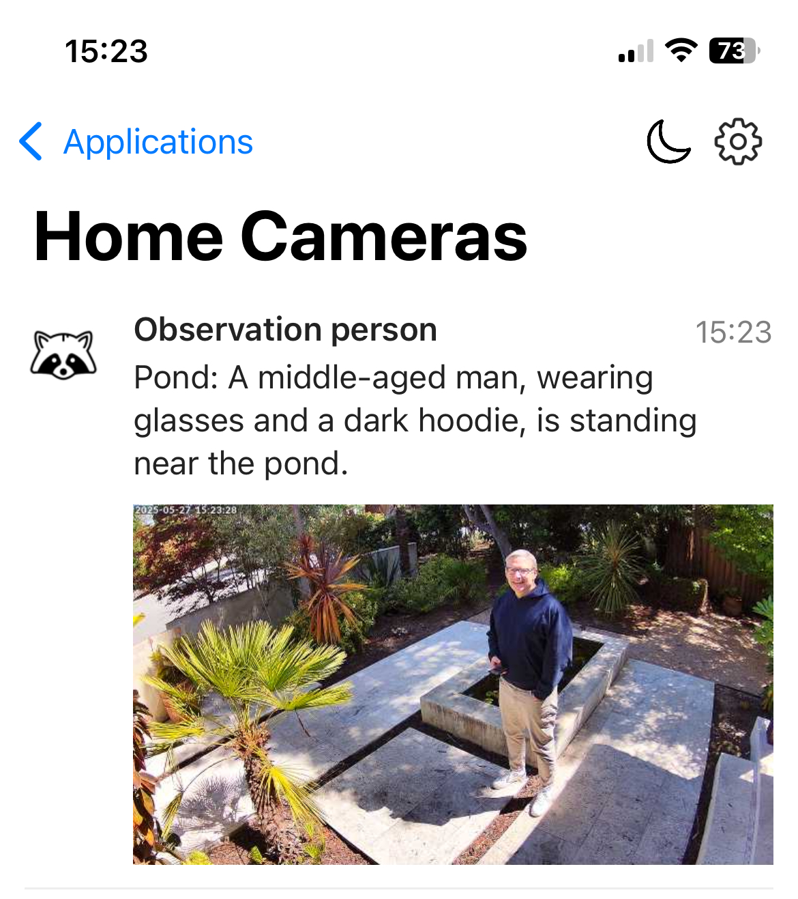

# AI Unifi Camera Security Monitor

A Python application that monitors UniFi Protect security cameras and uses OpenAI models to detect specific events, such as raccoons at the pond or unknown people at night. The rules for what to report are written as plain-language prompts, so they can be fairly complex.

The system analyzes camera feeds in real time and sends notifications with images via Pushover. It is written in Python, runs on a host or in a Docker container, and is open source (Apache 2.0).

## Features

The application offers real-time monitoring of UniFi Protect security cameras. In a nutshell it:
- Waits for Protect to report motion on a camera
- While motion lasts (up to 2 minutes), grabs a full-resolution frame from the camera's RTSPS stream every 2 seconds, so a frame that was misread at first gets another look
- Classifies each frame as a person, a raccoon, another animal, or nothing, using the OpenAI Decisions API (`gpt-6-luna`)
- Alerts immediately on raccoons, and asks `gpt-6-luna` what to report about people and other animals, based on rules in prompt files
- Pings [Healthchecks.io](https://healthchecks.io/) so you hear about it if the app goes down, and warns you if no motion has been processed for 12 hours
- Supports monitoring multiple cameras or only a single one

The notifications you receive include images and look like this.



## Setup

The application uses the `uv` package manager, which simplifies the setup process by handling most of the work, including installing dependencies. This means you don't have to manually manage Python packages or virtual environments, as `uv` takes care of it for you. Follow the steps below to get started:

1. Install the `uv` package manager if you haven't already. You can find the installation instructions on the [uv GitHub repository](https://github.com/astral-sh/uv).

2. Install `ffmpeg`, which is used to grab full-resolution frames (e.g. `brew install ffmpeg`). Without it the app falls back to Protect's 640x360 snapshots, which are too small to reliably tell a raccoon from a cat.

3. Clone the repository and navigate into the project directory.

4. Install the exact dependency versions from `uv.lock` (uiprotect releases have broken the app before):
   ```bash
   uv sync --frozen
   ```

5. Copy `animals.prompt.example` to `animals.prompt` and `person.prompt.example` to `person.prompt`, and adjust them (see below).

6. Set up your environment variables as described in the `env.example` file. You can copy this file to `.env` and fill in your actual credentials. For details see below.

7. Do a test run of the app. This will log the classification of each analyzed frame.
   ```bash
   uv run --env-file .env src/main.py --test
   ```

   **Note:** The `--env-file .env` flag tells `uv` to load environment variables from your `.env` file. This is the recommended way to run the application as it keeps your credentials secure and separate from your code.

## How Events Are Handled

Each frame is first classified as a person, a raccoon, another animal, or nothing:

- **Raccoon**: an immediate high-priority alarm, with no further model call.
- **Animal** (anything not positively identified as a raccoon): `gpt-6-luna` gets the image plus the rules in `animals.prompt`. The example rules report each new animal as an observation, raise an alert for coyotes and opossums, and stay quiet if the same kind of animal was already reported in the last hour.
- **Person**: only considered between 23:00 and 06:00. `gpt-6-luna` gets the image plus the rules in `person.prompt`, which describe your household so family members are reported as observations and anyone else as an alert.
- **Nothing**: ignored.

The model answers with `ALERT`, `OBSERVATION` or `NOACTION` and a short description. It also gets the current time and the last observation, so the prompts can refer to them. Lines in the prompt files beginning with `#` are ignored. Both prompt files are gitignored, since `person.prompt` describes your family.

The classification thresholds are in `src/classify.py`; priorities, night hours and repeat windows are in `src/alerts.py`.

## Notifications

The application can optionally use [Pushover](https://pushover.net/) for sending notifications. Pushover is a simple service that delivers notifications to your mobile devices and desktop. The system sends notifications with these priorities:

- **Raccoon alarm** (priority 1): makes your device sound and vibrate. Further raccoon frames within a minute are sent at normal priority.
- **ALERT** (priority 0): a normal notification, e.g. for a coyote or an unknown person at night.
- **OBSERVATION** (priority -2): delivered quietly without disturbing you.

The prompt-based model can never trigger a priority 1 alarm. A person is reported at most once every 2 minutes.

## Monitoring

Two checks make sure the app doesn't fail silently:

- **App down**: if `HEALTHCHECK_URL` is set, the app pings it every 5 minutes while its connection to Protect is healthy. Create a check on [Healthchecks.io](https://healthchecks.io/) with a 5 minute period and a 15–30 minute grace time, and it will notify you when the pings stop, including when the whole server is down.
- **No motion**: if no motion event has been processed for 12 hours, the app sends a normal-priority Pushover warning, and an all-clear when motion resumes. This catches cases where the app is up but no longer receives camera events, or the image models are failing. The timestamp is stored in `log/motion_state.json`, so it survives restarts.

## Environment Variables

The application requires several environment variables to be set. You can set these either in a `.env` file or directly in your environment. Here's a complete list of all variables:

### Required Variables

- `OPENAI_API_KEY`: Your OpenAI API key for image analysis
- `UNIFI_USERNAME`: Your UniFi Protect username
- `UNIFI_PASSWORD`: Your UniFi Protect password

### Optional Variables

- `UNIFI_HOST`: UniFi Protect host address (default: "192.168.1.1")
- `UNIFI_PORT`: UniFi Protect port (default: 443)
- `CAMERA_FILTER`: Name of a specific camera to monitor (if not set, all cameras will be monitored)
- `TIMEZONE`: Timezone for camera location (e.g., 'America/Los_Angeles', 'Europe/London', 'Asia/Tokyo')
  - If not set, the server's local time will be used
  - UTC is not recommended; use a more specific timezone instead
  - Wrong time zone can confuse the LLM (e.g. image shows daytime, but time is night time)
- `UNIFI_RTSPS_PORT`: Port of Protect's RTSPS streams (default: 7441). RTSP must be enabled for the camera in Protect to get full-resolution frames.
- `HEALTHCHECK_URL`: Healthchecks.io ping URL (see Monitoring)
- `HEALTHCHECK_INTERVAL_SECONDS`: How often to ping it (default: 300)
- `NO_MOTION_ALERT_HOURS`: Hours without motion before warning (default: 12)

### Pushover Notification Variables (Required if using `--notify`)

- `PUSHOVER_API_TOKEN`: Your Pushover application token
- `PUSHOVER_USER_KEY`: Your Pushover user key

Example `.env` file:
```bash
# OpenAI API key for image analysis
OPENAI_API_KEY=sk-your-openai-api-key

# UniFi Protect credentials
UNIFI_USERNAME=your-unifi-username
UNIFI_PASSWORD=your-unifi-password
UNIFI_HOST=192.168.1.1
UNIFI_PORT=443

# Pushover credentials for notifications
PUSHOVER_API_TOKEN=your-pushover-app-token
PUSHOVER_USER_KEY=your-pushover-user-key

# Optional: Filter to monitor only a specific camera
CAMERA_FILTER=FrontDoor

# Timezone for camera location
TIMEZONE=America/Los_Angeles

# Optional: Healthchecks.io ping URL
HEALTHCHECK_URL=https://hc-ping.com/your-check-uuid
```

## Command Line Arguments

The application supports the following command line arguments:

- `--test`: Enable test mode to analyze a frame on every camera update, not just when motion is detected. Note: This can get expensive as it sends many images to OpenAI.
- `--quiet`: Disable console output (logs will still be written to file)
- `--notify`: Enable Pushover notifications (default is off). Without it, decisions are only logged.
- `--testalarm`: Send a test alarm notification and exit (useful for testing notification setup)
- `--scheduled-exit`: Exit daily at 8pm so the container's restart policy restarts the app (used in the Docker image)

**Note:** When using `uv run`, you can use the `--env-file .env` flag to automatically load environment variables from your `.env` file.

Example usage:
```bash
# Run with notifications enabled
uv run --env-file .env src/main.py --notify

# Run in test mode with notifications
uv run --env-file .env src/main.py --test --notify

```

## Setting Up Pushover

1. Create a Pushover account at [pushover.net](https://pushover.net/)
2. Install the Pushover app on your mobile device
3. Create a new application in your Pushover dashboard
4. Note down your:
   - User Key (found in your Pushover dashboard)
   - API Token (from your new application)
5. Add these to your `.env` file:
   ```bash
   PUSHOVER_API_TOKEN=your-app-token
   PUSHOVER_USER_KEY=your-user-key
   ```

To enable notifications, run the application with the `--notify` flag:
```bash
uv run --env-file .env src/main.py --notify
```

You can test your notification setup using:
```bash
uv run --env-file .env src/main.py --testalarm
```

## Docker Container

The application can be run in a Docker container, which provides an isolated environment with all dependencies pre-installed. You need outbound connectivity from the container to the Ubiqiti system and OpenAI.

1. Build the container:
   ```bash
   docker build -t camera-app .
   ```

2. Run the container with your environment variables:
   ```bash
   docker run -it --env-file .env camera-app
   ```

The container will automatically start the application with notifications and the daily 8pm exit enabled, so run it with a restart policy (e.g. `--restart unless-stopped`). The prompt files are copied into the image, so create them before building. `make deploy` builds an amd64 image, pushes it and restarts the container on the deploy server.

## License

This project is licensed under the Apache License, Version 2.0. See the LICENSE file for more details.

